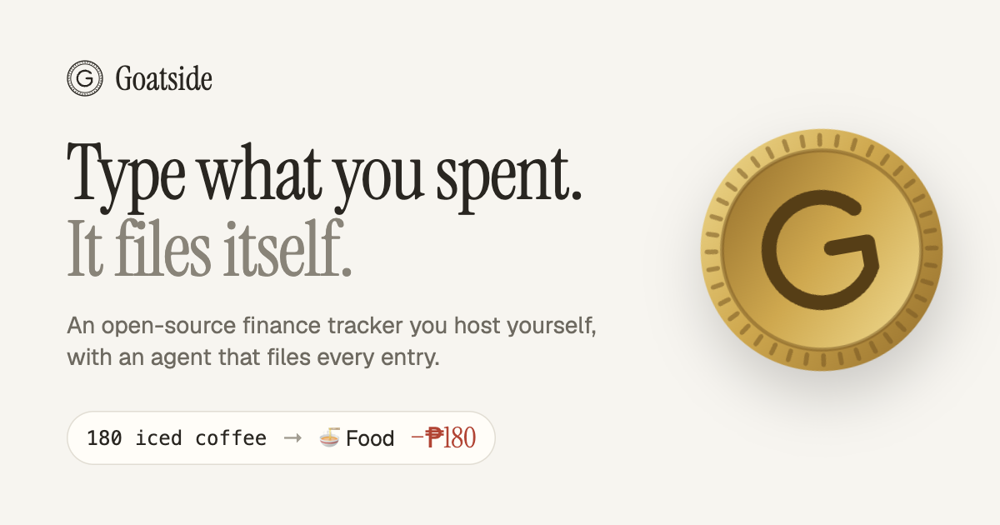

# Goatside



Goatside is an open-source personal finance tracker that you host yourself. Type what
you spent or received in plain words, like `180 iced coffee`, and its agent files it
with a category, an account, and who owes whom.

On your phone it's a quick logger with an agent to chat with. On a wide screen it's a
dashboard for reviewing your money, with charts and a full transactions table.

It's built for one person. There's no hosted service. You deploy your own copy to Vercel
with your own Turso database and AI Gateway, and sign in with the one account set in its
environment.

[](./LICENSE)

## Features

- **Logging in plain words.** Code reads the amount, date, split and account exactly as
  you typed them. The agent picks the category and whether money went out or came in,
  and learns from the entries you've confirmed.
- **An agent that asks.** When it isn't sure, the entry is saved with its best guess and
  a one-tap question appears ("₱500 for 'lunch': money out or in?").
- **People and IOUs.** "lent nini 1000", "daniel paid me back" and "dinner with nini and
  daniel split 3" become loans, repayments and split bills, with one-tap settle.
- **Accounts and transfers.** Banks, e-wallets, credit cards and cash, each with its
  balance. Moving money between your own accounts is a transfer, not spending.
- **Statement imports.** Pick a bank or card statement, PDF or CSV, and Goatside adds the
  rows you didn't log and links the ones you did. Every row has to add up to the
  statement's own balances, or nothing is imported.
- **Asking and doing.** Ask "how much on food this month?" and the agent answers from
  your ledger. Ask it to "move all grab rides this month to Transport" and it shows
  exactly what will change before it does anything, and you can undo it.
- **Your currency.** Pick it in Settings. It starts as Philippine pesos.
- **Works offline.** Install it on your phone. Entries typed with no signal wait on the
  phone and sync when you're back online.
- **Works without AI.** Without AI Gateway, entries still save, and you file them by
  hand.

## What leaves your instance

Your ledger lives in your own Turso database. Two things go out, both through your own
Vercel AI Gateway:

- The text and amount of each entry you log, to TypeSafe's
  [Jev](https://docs.typesafe.ai/) for filing. That includes the new rows of an imported
  statement.
- Your questions to the agent and the ledger rows it looks up to answer them, to
  DeepSeek V4.1 Flash.

Statement files and their passwords never leave your device. Goatside collects nothing:
no analytics, no telemetry, no account with us. See
[What leaves your instance](apps/web/content/docs/guide/privacy.mdx).

## Deploy your own

You'll need GitHub and [Vercel](https://vercel.com) accounts. Node 24 or newer and
[pnpm](https://pnpm.io) are only needed to set up the database from your computer.

1. [Fork the repo](https://github.com/joshxfi/goatside/fork).
2. Import your fork in Vercel with **Root Directory** set to `apps/goatside`, and add
   `GOATSIDE_USERNAME`, `GOATSIDE_PASSWORD` (12 or more characters) and `SESSION_SECRET`
   (`openssl rand -base64 32`) as environment variables.
3. Add a [Turso](https://turso.tech) database. Either create one from your Vercel
   project's **Storage** tab, which sets `TURSO_DATABASE_URL` and `TURSO_AUTH_TOKEN` for
   you, or create it with the [Turso CLI](https://docs.turso.tech/cli) and add those two
   variables yourself.
4. Apply the migrations. Either add the URL and token as Actions secrets on your fork and
   run the CI workflow, or run
   `TURSO_DATABASE_URL=<url> TURSO_AUTH_TOKEN=<token> pnpm db:migrate` from your clone.
5. Enable AI Gateway on your Vercel team and buy credit. $10 is the smallest top-up, and
   the free monthly credit doesn't cover Goatside's models. Then redeploy and sign in.

The [full guide](apps/web/content/docs/self-hosting/index.mdx) covers each step, plus
[updating](apps/web/content/docs/self-hosting/updating.mdx), the
[database](apps/web/content/docs/self-hosting/database.mdx) and
[security](apps/web/content/docs/self-hosting/security.mdx).

## Local development

Requires Node 24+, pnpm and the [Turso CLI](https://docs.turso.tech/cli) for the local
database.

```sh
pnpm install
cp apps/goatside/.env.example apps/goatside/.env.local   # then fill it in
pnpm dev          # local DB on :8080, app on :3000, landing on :3001
pnpm db:migrate   # first run, and after schema changes
```

Sign in at http://localhost:3000 with the `GOATSIDE_USERNAME` and `GOATSIDE_PASSWORD`
from your `.env.local`.

```sh
pnpm typecheck
pnpm test         # vitest
pnpm lint         # oxlint
pnpm format       # oxfmt
pnpm db:generate  # a new migration after editing packages/db/src/schema
pnpm db:studio    # browse the local DB
TURSO_DATABASE_URL=http://127.0.0.1:8090 pnpm --filter @workspace/db demo
                  # 3 months of sample data in a separate local DB
pnpm --filter @workspace/ai eval   # live filing evals (needs AI_GATEWAY_API_KEY)
```

Add shadcn components from an app directory. They're installed into `packages/ui`:

```sh
pnpm dlx shadcn@latest add drawer -c apps/goatside
```

## Project layout

| Path            | What                                                          |
| --------------- | ------------------------------------------------------------- |
| `apps/goatside` | The app you self-host (TanStack Start, deployed to Vercel)    |
| `apps/web`      | The landing page and docs (TanStack Start + Fumadocs)         |
| `packages/core` | Pure TS: the entry parser, account matching, money, dates     |
| `packages/db`   | Drizzle schema and migrations for Turso (libSQL)              |
| `packages/auth` | Single-account auth: env credentials, signed session cookie   |
| `packages/ai`   | The agent: Jev filing policy, ask-mode instructions           |
| `packages/ui`   | shadcn/ui components (Base UI), the coin brand, theme, styles |

## Contributing

Issues and pull requests are welcome. For anything larger than a fix, open an issue
first so we can agree on the approach.

- Read [`AGENTS.md`](./AGENTS.md) and the one in the folder you're changing. They hold
  the rules the code follows, like integer cents for money and soft deletes everywhere.
- Run `pnpm format`, `pnpm lint`, `pnpm typecheck` and `pnpm test` before you push. CI
  runs the same checks.
- Fix a ledger bug with a failing test first.
- Write each commit, and the pull request title, as a
  [Conventional Commit](https://www.conventionalcommits.org), like
  `fix(app): keep the outbox order after a retry`. Pull requests are squash-merged or
  rebased onto `main`, and either way those messages become the changelog. Checks
  enforce both, and `pnpm commitlint --from origin/main` lints your branch locally.
  Mark a breaking change with `!`, like `feat(db)!: …`.
- When a change affects how Goatside behaves, update the docs in
  `apps/web/content/docs` in the same pull request.

## Releases

[release-please](https://github.com/googleapis/release-please) keeps a release pull
request open with the next version and its changelog, built from the commits on `main`.
Merging it tags the version and publishes it on
[GitHub Releases](https://github.com/joshxfi/goatside/releases). Before 1.0, a `feat`
bumps the minor version and a `fix` the patch. Changes are listed in
[`CHANGELOG.md`](./CHANGELOG.md).

## Security

Please report vulnerabilities privately through **Security → Report a vulnerability** on
GitHub, not in a public issue.

## License

[MIT](./LICENSE). Built by Josh Daniel ([@joshxfi](https://github.com/joshxfi)).
